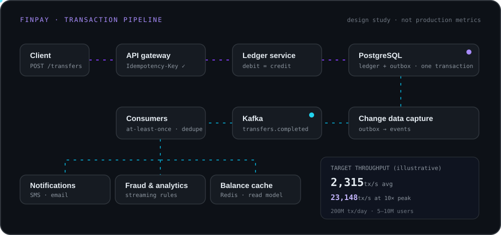

<div align="center">



<a href="https://git.io/typing-svg"></a>

<p>
  <a href="https://waona.ke"></a>
  <a href="https://www.linkedin.com/in/muganda-james-391a65332"></a>
  <a href="mailto:mugandajames403@gmail.com"></a>
  
</p>

</div>


## 👋 About me



<details>
<summary><b>The same thing, as Python</b> 🐍</summary>

```python
class JamesJumaMuganda:
    def __init__(self):
        self.role = "Backend Engineer · Founder & CEO, WAONA"
        self.based_in = "Nairobi, Kenya"
        self.education = "BSc Computer Science, Catholic University of Eastern Africa (2027)"
        self.primary_language = "Python"
        self.focus = [
            "Backend Engineering",
            "System Design",
            "Software Architecture",
            "APIs and Distributed Systems",
            "Infrastructure and DevOps",
        ]

    def current_goal(self) -> str:
        return "Build reliable, scalable software systems"
```

</details>

- 🏢 Founder & CEO of **[WAONA](https://waona.ke)**, a technology company building its own products and custom software for businesses.
- 🎓 BSc Computer Science at CUEA (graduating 2027).
- 🐍 Python backend engineering with **FastAPI** and **Flask**.
- 🏗️ System design, **Domain-Driven Design** and clean architecture.
- 🗄️ Relational data modelling, transactions and persistence patterns.
- 🐳 Docker, Kubernetes and Linux in practice.
- 🧪 Testing, security and code that's easy to maintain.
- 🤖 Exploring machine learning with PyTorch.


## 🧰 Tech stack

<div align="center">

**Languages**<br/>


**Backend**<br/>


**Data**<br/>


**Infrastructure**<br/>


**Machine learning**<br/>


</div>


## 🚀 Featured work

### 🏢 WAONA: [waona.ke](https://waona.ke)

Technology that moves businesses forward. WAONA builds its own products and engineers custom software for businesses across Kenya.

| Product | What it does |
| :-- | :-- |
| 🎟️ **WAONA Tickets** | Event discovery, checkout, QR tickets and fast gate check-in for events across Kenya. FastAPI backend. |
| 🛡️ **WAONA Identity** | One secure account and sign-in across every WAONA product, built on OAuth 2.0 and OpenID Connect. |

### 🏠 Nyumba Management System

A property and tenant management backend built around clear business rules and a layered, testable architecture: properties, tenants, leases, rent, role-based access and M-Pesa payments.



`FastAPI` `DDD` `Repository + Unit of Work` `PostgreSQL` `SQLAlchemy` `Alembic` `Pytest` `RBAC` `M-Pesa`

### 💳 FinPay: financial system design

A design study of reliable money movement: idempotent APIs, a double-entry ledger, a transactional outbox and event streaming for downstream consumers.



> **Illustrative design targets, not measured production results:** 5–10M users · 200M transactions/day · ~2,315 tx/s average · ~23,148 tx/s at a 10× peak.

<p align="center"><a href="https://github.com/MugandaJames?tab=repositories"></a></p>


## 📊 GitHub activity

<div align="center">


<picture>
  <source media="(prefers-color-scheme: dark)" srcset="https://raw.githubusercontent.com/MugandaJames/MugandaJames/output/github-snake-dark.svg" />
  <source media="(prefers-color-scheme: light)" srcset="https://raw.githubusercontent.com/MugandaJames/MugandaJames/output/github-snake.svg" />
  
</picture>

</div>

<sub>Stats, streak and activity cards come from free community services and can occasionally be slow or unavailable. GitHub's own contribution calendar is the source of truth.</sub>


## 🎯 What I'm working toward

- Secure, maintainable, production-ready backend applications.
- Distributed systems and system design at scale.
- Database design, transactions, concurrency and performance.
- Consistent testing and engineering discipline.
- Deployment and infrastructure with Docker, Kubernetes and Linux.
- Sound architectural decisions as systems grow.

<div align="center">


</div>
